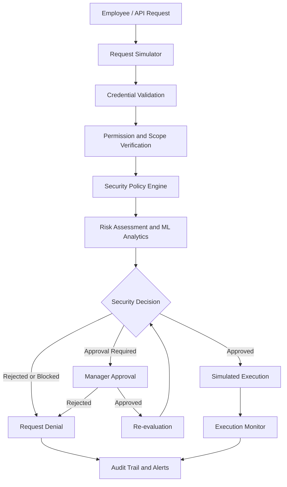

# 🛡️ GATEKEEPER
### Credential-Aware Approval Gate for Sensitive Financial API Actions

**GATEKEEPER** is a cybersecurity prototype designed to detect, evaluate and control sensitive financial API requests before execution. It combines credential validation, permission and scope verification, policy enforcement, risk assessment, manager approval, simulated execution and security monitoring into a centralized authorization workflow.

**Project Type:** Cybersecurity | API Security | Risk Analysis | Access Control | Machine Learning | Full-Stack Development

**Team:** Visionary Vixens

---

## 📌 1. Problem Statement

Financial APIs are vulnerable to misuse when credentials are compromised, access permissions are overly broad, sensitive requests bypass approval procedures or suspicious activities go undetected.

Traditional authentication alone cannot guarantee that an authenticated user is authorized to perform a particular sensitive action.

For example, an employee or application may possess a valid API credential but attempt an unauthorized supplier bank account modification or another sensitive financial operation.

GATEKEEPER addresses this problem by introducing a centralized security gate that evaluates financial API requests against multiple security conditions before allowing simulated execution.

The objective is to reduce unauthorized access, credential misuse, excessive permissions and unapproved financial operations through layered security controls.

---

## 💡 2. Proposed Solution

GATEKEEPER acts as an intelligent authorization layer between a user initiating a financial API request and its simulated execution.

Each request undergoes multiple security checks:

- User identity and credential validation.
- Permission and API scope verification.
- Security policy evaluation.
- Transaction risk assessment.
- Manager approval when required.
- Execution authorization and monitoring.
- Audit logging and security alert generation.

Based on the evaluation, the system determines whether a request can proceed, requires additional approval or must be blocked.

The system operates in a simulated financial environment without connecting to real banking systems.

---

## 🚀 3. Key Features

### 🔐 Credential Security
- Credential management and validation.
- Credential health monitoring.
- Credential-aware request evaluation.
- Monitoring of credential status and expiry.

### 🛂 Permission and Scope Enforcement
- Role-Based Access Control (RBAC).
- API scope verification.
- Permission-based authorization.
- Access control before simulated execution.

### ⚙️ Security Policy Engine
- Policy-based request evaluation.
- Configurable security rules.
- Evaluation of multiple security conditions.
- Centralized policy enforcement.

### 📊 Risk Assessment
- Risk analysis of financial API requests.
- Risk indicators and assessment results.
- Risk monitoring dashboard.
- Integration with Machine Learning analytics components.

### 👨‍💼 Manager Approval Workflow
- Approval-based handling of sensitive requests.
- Manager approval interface.
- Approval and rejection tracking.
- Separation of employee and manager responsibilities.

### 🤖 Machine Learning Analytics
- ML-based risk analytics components.
- Data-driven security analysis.
- Integration with the risk-monitoring workflow.

### 🧾 Audit Trail
- Audit event monitoring.
- SHA-256 hash-chain-based audit trail interface.
- Security event traceability.
- Audit integrity verification.

### 🚨 Security Alerts
- Security alert monitoring.
- Open alert tracking.
- Monitoring of potentially suspicious activity.

### 📈 Interactive Dashboard
- Executive dashboard.
- Financial API request simulator.
- Risk and decision monitoring.
- Execution monitoring.
- Credential health monitoring.
- Security analytics.

---

## 🔄 4. System Workflow

1. **Request Initiation:** An employee initiates a simulated financial API request.
2. **Credential Validation:** The system evaluates the credentials associated with the request.
3. **Permission Verification:** The user's roles, permissions and API scopes are checked.
4. **Policy Evaluation:** Applicable security policies are evaluated.
5. **Risk Assessment:** The request undergoes risk analysis.
6. **Approval Gate:** Requests requiring additional authorization are routed through the manager approval workflow.
7. **Execution Decision:** The system determines whether the request can proceed, must be held or should be denied.
8. **Monitoring and Auditing:** Request outcomes and related security events are reflected in monitoring and audit interfaces.

---

## 🏗️ 5. System Architecture



---

## 🛠️ 6. Technology Stack

| Component | Technology |
|---|---|
| Frontend | React |
| Frontend Build Tool | Vite |
| Backend | Python |
| API Framework | FastAPI |
| Database | Project-configured database |
| Machine Learning | Python-based ML components |
| API Documentation | Swagger UI / OpenAPI |
| Version Control | Git |
| Repository Hosting | GitHub |

---

## 🖥️ 7. Dashboard Modules

The application includes the following operational modules:

1. Executive Dashboard
2. Request Simulator
3. Execution Monitor
4. Employee Approvals
5. Manager Approvals
6. Credentials
7. Permissions & Scopes
8. Supplier Registry
9. Policies (P1–P8)
10. Risk Assessment
11. ML Analytics
12. Audit Trail (Hash Chain)
13. Credential Health
14. Security Alerts
15. System Settings

---

## 📂 8. Project Structure

```text
GATEKEEPER/
│
├── backend/
│   ├── app/
│   ├── db/
│   ├── ml/
│   ├── tests/
│   └── requirements.txt
│
├── frontend/
│   ├── public/
│   ├── src/
│   │   ├── components/
│   │   ├── context/
│   │   └── pages/
│   ├── package.json
│   └── vite.config.js
│
├── docs/
│   ├── ARCHITECTURE.md
│   ├── IMPLEMENTATION_REPORT.md
│   └── SECURITY.md
│
├── .gitignore
├── README.md
└── LICENSE
```

*The actual implementation may contain additional files and modules.*

---

## ⚙️ 9. Installation and Setup

### Prerequisites

Install the following software:

- Python 3.11
- Node.js and npm
- Git
- VS Code or another code editor
- Windows, Linux or macOS

### Step 1: Clone the Repository

```bash
git clone https://github.com/YOUR_USERNAME/GATEKEEPER.git
cd GATEKEEPER
```

Replace `YOUR_USERNAME` with your GitHub username.

### Step 2: Configure the Backend

Navigate to the backend directory:

```bash
cd backend
```

Create a Python virtual environment:

```bash
python -m venv .venv
```

Activate it on Windows PowerShell:

```powershell
.\.venv\Scripts\Activate.ps1
```

On Linux/macOS:

```bash
source .venv/bin/activate
```

Install backend dependencies:

```bash
pip install -r requirements.txt
```

Configure the environment variables using the project's `.env.example` file, if provided.

Initialize the database using the project's configured initialization or seed procedure, if required.

Start the backend:

```bash
python -m uvicorn app.main:app --reload --host 127.0.0.1 --port 8000
```

Backend URL:

http://127.0.0.1:8000

Swagger API Documentation:

http://127.0.0.1:8000/docs

### Step 3: Configure the Frontend

Open a new terminal and navigate to the frontend directory:

```bash
cd GATEKEEPER/frontend
```

Install frontend dependencies:

```bash
npm install
```

Start the frontend development server:

```bash
npm run dev
```

Frontend URL:

http://localhost:5173

Keep both backend and frontend servers running while using the application.

### Step 4: Verify the Application

- Open the frontend in your browser.
- Log in using the configured demonstration account, if authentication is enabled.
- Open the request simulator.
- Submit a simulated financial API request.
- Observe credential and permission validation.
- Review risk assessment and security decisions.
- Test the manager approval workflow.
- Review execution monitoring, alerts and audit records.

---

## 🔒 10. Security Design Considerations

GATEKEEPER demonstrates multiple security concepts:

- Credential-aware authorization.
- Role-Based Access Control.
- Permission and API scope enforcement.
- Policy-based security decisions.
- Risk-oriented request assessment.
- Approval gates for sensitive operations.
- Execution monitoring.
- Audit event traceability.
- Separation of duties.

The system follows a layered security approach in which authentication, authorization, risk assessment and approval work together.

---

## 🎯 11. Project Objectives

- Reduce misuse of valid or compromised credentials.
- Prevent unauthorized financial API operations.
- Enforce appropriate access permissions.
- Identify potentially suspicious transaction behaviour.
- Introduce additional approval for sensitive actions.
- Improve security monitoring and accountability.
- Demonstrate layered authorization in a simulated financial environment.

---

## ⚠️ 12. Scope and Limitations

- GATEKEEPER is a cybersecurity prototype developed for demonstration and experimentation.
- Financial API requests and execution workflows are simulated.
- The system is not connected to real banking systems, payment gateways or financial accounts.
- Risk and ML analytics should not be interpreted as production-grade fraud detection.
- The prototype is not a certified financial security system.
- Production deployment would require additional security testing, infrastructure hardening, monitoring, compliance assessment and independent validation.

---

## 🔮 13. Future Enhancements

- Integration with authorized financial API sandbox environments.
- Advanced anomaly detection models.
- Adaptive risk scoring.
- Stronger authentication mechanisms and Multi-Factor Authentication.
- Automated credential rotation.
- Just-In-Time temporary access.
- Request-bound, single-use HMAC authorization tokens.
- Real-time security monitoring.
- Threat intelligence integration.
- Containerized deployment.
- Comprehensive automated security testing.
- Integration with Security Information and Event Management platforms.

---

## 👥 14. Contributors

**Team Visionary Vixens**

Developed as a cybersecurity prototype exploring credential-aware approval mechanisms, layered authorization and risk-based security controls for sensitive financial API operations.

---

## 📜 15. License

This project has not been released under an open-source license. All rights are reserved by the project contributors unless otherwise stated.

---

### GATEKEEPER

**Securing Sensitive API Actions Through Credential-Aware Authorization and Risk-Based Approval.**
